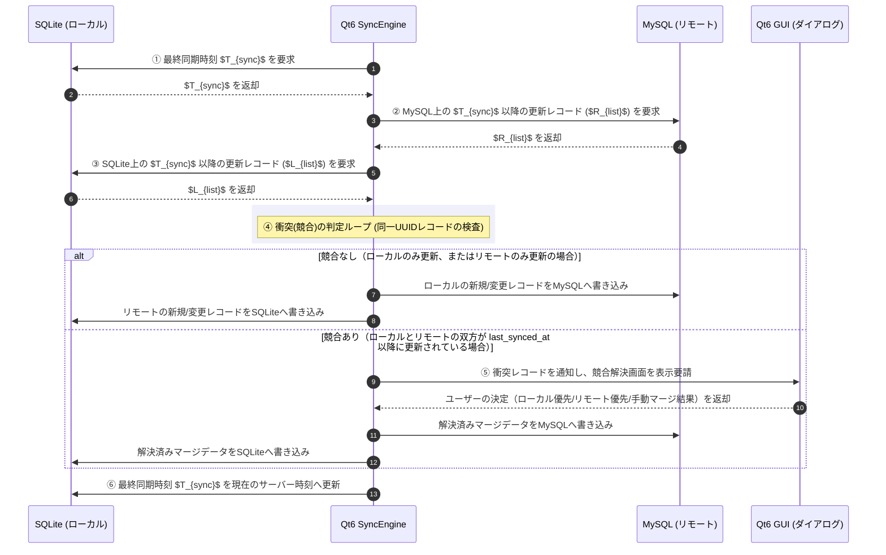

# TaskFlow 詳細設計書 (Detail Design)

本システムにおいて、同期アルゴリズム、作業負荷計算ロジック、および暗号化連携の例外ハンドリングといったコアロジックの動作フローを定義します。

---

## 1. 同期アルゴリズムと競合（衝突）解決シーケンス

C++（Qt6）アプリと Web（MySQL）側が双方向で同期する際の具体的なデータ処理手順と競合判定をシーケンスとして定義します。

### 1.1. 同期のトリガーと事前処理
1. **オンライン疎通確認**: C++アプリは定期的に、または手動同期のタイミングで MySQL データベースへの接続テストを実行します。
2. **最終同期時刻の取得**: SQLiteの `sync_metadata` テーブルから設定キー `last_synced_at` の値（タイムスタンプ $T_{sync}$）を取得します。
   * 初期状態（未同期）の場合、$T_{sync} =$ `'1970-01-01 00:00:00'` とします。

### 1.2. 双方向同期処理のシーケンス



### 1.3. 競合（衝突）解決オプションのデータ処理
同一UUIDのレコードで衝突があった場合のデータマージ方法：
1. **ローカル側（SQLite）を優先する場合**:
   * リモート(MySQL)に対して、ローカルレコードを上書き（`UPDATE`）します。
   * `updated_at` を現在のシステム時刻に再更新し、同期の連鎖が無限ループしないように確定させます。
2. **Web側（MySQL）を優先する場合**:
   * ローカル(SQLite)に対して、リモートレコードを上書き（`UPDATE`）します。
   * `updated_at` はリモートの値をそのまま維持し、同期完了とみなします。
3. **手動解決（再編集）の場合**:
   * ユーザーがダイアログ上のマージ入力欄で編集した結果を適用します。
   * 作成されたマージデータ（`updated_at` を現在のシステム時刻に更新）を、ローカル（SQLite）とリモート（MySQL）の双方に `UPDATE` して保存します。

---

## 2. 作業時間枠の負荷オーバーフロー警告ロジック

タスクの「重み」が、割り当てられた作業時間枠の制限時間をオーバーしているかどうかを判定するロジックです。

### 2.1. 負荷計算の対象とデータ単位
* **計算タイミング**:
  * Web / C++アプリの予定表示画面（カレンダー/ガントチャート）のロード・描画時。
  * タスクの追加・編集、カレンダー上でのドラッグ＆ドロップによる時間枠・日付の移動検知時。
* **集計単位**: 「日付」ごと、かつ「時間枠（`time_slot_id`）」ごとに集計します。
* **集計対象タスク**:
  * `schedules.type = 'task'`（タスク）であること。
  * `status != 'done'`（未完了状態のタスクのみを集計対象とし、完了済みタスクの重みは除外します）。
  * `is_deleted = 0` であること。

### 2.2. 計算アルゴリズム
特定の日付 $D$ と、作業時間枠 $S$ において：
1. 日付 $D$ の時間枠 $S$ に割り当てられているタスクの集合 $T_{D,S}$ を抽出します。
   * 条件: `time_slot_id = S.id` 且つ `start_at` の日付部分が $D$。
2. 集合 $T_{D,S}$ に含まれる各タスクの `weight` （所要時間：時間単位）の合計値 $W_{total}$ を算出します。
   $$W_{total} = \sum_{t \in T_{D,S}} t.weight$$
3. 時間枠 $S$ の制限時間 $S.limit\_hours$ と $W_{total}$ を比較します。
4. **判定と視覚効果**:
   * $W_{total} > S.limit\_hours$ の場合 ＝ **負荷オーバー警告（警告マーク表示、枠の黄色/赤ハイライト）**。
   * 超過量 = $W_{total} - S.limit\_hours$

---

## 3. TransCipher 接続設定および例外処理

### 3.1. PHP 側の TransCipher 呼び出しと接続例外ハンドリング
PHP側では、データの暗号化・復号処理を外部のAPIサーバーに委譲します（`CipherEngine.php`）。
そのため、ネットワークタイムアウトやAPIサーバー停止などの「API接続エラー」に対する例外処理が必要です。

* **例外処理フロー**:
  * 接続失敗（APIが `null` または非200レスポンスを返した）時、システムはデータ保存/復号処理を中断し、データベースのトランザクションを **ロールバック** します。
  * ユーザーに対しては「セキュアデータ接続エラーにより保存に失敗しました」等の明確なエラーメッセージを提示し、データが中途半端に未暗号化のまま保存されたり、破壊されたりするのを防ぎます。
* **接続パラメータ定義**:
  * `src/config.php` または `.env` 等で以下のように秘密鍵とAPI情報を定義し、起動時に `CryptoUtil::init()` で一括ロードします。

```php
// config.php
define('TRANSCIPHER_KEY', 'your-secret-salt-key-here');
define('TRANSCIPHER_API_URL', 'https://streamers-tool.sakura.ne.jp/TransCipher/api.php');
define('TRANSCIPHER_API_TOKEN', 'your-authorized-token-here');
```

```php
// Exception Handling Example in PHP Wrapper
class CryptoUtil {
    public static function decrypt(string $cipherTextBase64): ?string {
        $binary = base64_decode($cipherTextBase64, true);
        if ($binary === false) return null;
        
        $plain = CipherEngine::decrypt($binary, self::$secretKey);
        if ($plain === null) {
            // 例外をスローし、呼出元でDBロールバック等を実行
            throw new \RuntimeException("TransCipher API communication failed or Invalid Secret Key.");
        }
        return $plain;
    }
}
```

### 3.2. C++ 側の DLL 読み込みと例外ハンドリング
C++アプリ側では、ローカルの `TransCipher.dll` などを動的リンクして利用します。

* **DLL読み込み・初期化チェック**:
  * アプリ起動時に `TransCipher.dll` がシステムパスまたは実行バイナリと同ディレクトリに存在するかを確認します。存在しない場合は警告ダイアログを表示して終了します。
* **復号エラー時の対応**:
  * `CipherEngine::decrypt` の実行結果（`CipherResult`）が `CipherError::InvalidHeader` または `CipherError::ProcessFailed` を返した場合、現在の暗号化キー（秘密鍵）が不一致であると判断します。
  * アプリは直ちにローカルデータの読み込み処理を中断し、ユーザーに「暗号化キーが異なります。設定画面で正しい秘密鍵を入力してください」と促すダイアログを表示します。
