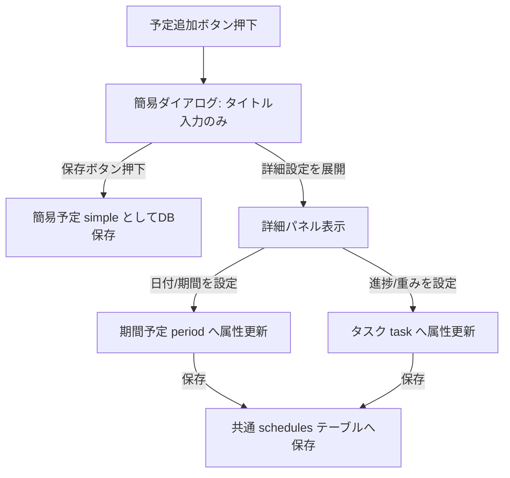

# TaskFlow 詳細設計書 (Detailed Design)

本設計書は、基本設計に基づき、PHP（Web側）および C++（Qt6デスクトップ側）の各機能モジュールの具体的なクラス設計、関数定義（メソッドシグネチャ）、実行されるSQLクエリ、および同期アルゴリズムの詳細な処理フローを定義します。

---

## 1. 開発ディレクトリ構成

各機能モジュールの独立性を確保するため、以下のディレクトリ構造で実装を行います。

### 1.1. PHP (Web側) ディレクトリ構成
```
TaskFlow/
├── config/
│   └── config.php            # 環境設定（DB接続、TransCipherトークン等）
├── database/
│   ├── schema.sql            # MySQLスキーマ
│   └── schema_sqlite.sql     # SQLiteスキーマ
├── doc/
│   ├── basic_design.md       # 基本設計書
│   └── detail_design.md      # 詳細設計書 (本ファイル)
├── src/
│   ├── Common/
│   │   └── Security/
│   │       └── CryptoUtil.php # TransCipher ラッパー
│   ├── Holiday/
│   │   └── HolidayParser.php  # 祝日CSV解析
│   ├── Notification/
│   │   └── DiscordNotifier.php# Discord Webhook通知
│   └── Repository/
│       ├── ScheduleRepository.php
│       ├── TimeSlotRepository.php
│       └── WebhookRepository.php
└── public/
    ├── index.php             # 一般閲覧用画面 (カレンダー・ガントチャート)
    └── admin.php             # 管理用Web API / 簡易ダッシュボード
```

### 1.2. C++ (Qt 6 デスクトップ側) ディレクトリ構成
```
TaskFlow-Client/
├── CMakeLists.txt            # ビルド定義
├── include/
│   # TransCipher 公開ヘッダー (TransCipher-Dist からコピー)
│   ├── cipher_engine.h
│   └── ...
├── src/
│   ├── main.cpp
│   ├── common/
│   │   ├── crypto_util.h     # TransCipher ラッパー
│   │   └── crypto_util.cpp
│   ├── database/
│   │   ├── db_manager.h      # SQLite/MySQL コネクション管理
│   │   ├── db_manager.cpp
│   │   ├── local_storage.h   # SQLiteデータ操作
│   │   ├── local_storage.cpp
│   │   ├── remote_storage.h  # MySQLデータ操作
│   │   └── remote_storage.cpp
│   ├── model/
│   │   ├── schedule.h        # 予定データ構造
│   │   ├── time_slot.h       # 時間枠データ構造
│   │   └── webhook.h         # Webhookデータ構造
│   ├── sync/
│   │   ├── sync_engine.h     # 同期・衝突検知ロジック
│   │   └── sync_engine.cpp
│   ├── scheduler/
│   │   ├── scheduler.h       # 負荷警告計算エンジン
│   │   └── scheduler.cpp
│   └── ui/
│       ├── mainwindow.h      # メイン画面
│       ├── mainwindow.cpp
│       ├── mainwindow.ui
│       ├── conflict_dialog.h # 競合解決ダイアログ
│       ├── conflict_dialog.cpp
│       └── conflict_dialog.ui
└── thirdparty/
    └── transcipher/          # TransCipher.dll (Windows), libTransCipher.so (Linux) 等の配置
```

---

## 2. PHP (Web側) クラス・メソッド詳細設計

### 2.1. `CryptoUtil` クラス
`TransCipher` への依存を隠蔽し、Base64 文字列のやり取りを行います。

```php
namespace App\Common\Security;

use TransCipher\CipherEngine;
use TransCipher\RecipeManager;

class CryptoUtil {
    private static string $secretKey = "";

    // 接続設定と秘密鍵の初期化
    public static function init(string $secretKey, string $apiUrl, string $apiToken): void {
        self::$secretKey = $secretKey;
        CipherEngine::configure($apiUrl, $apiToken);
    }

    // 文字列を暗号化し、Base64形式で返却する。エラー時は RuntimeException をスロー
    public static function encrypt(string $plainText): string {
        if (empty($plainText)) return "";
        $cipherBinary = CipherEngine::encrypt($plainText, self::$secretKey, RecipeManager::MODE_MANDATORY, "2.0");
        if ($cipherBinary === null) {
            throw new \RuntimeException("TransCipher encryption failed. Check API configuration or network.");
        }
        return base64_encode($cipherBinary);
    }

    // Base64暗号化文字列を復号し、平文で返却する。エラー時は RuntimeException をスロー
    public static function decrypt(string $cipherTextBase64): string {
        if (empty($cipherTextBase64)) return "";
        $binary = base64_decode($cipherTextBase64, true);
        if ($binary === false) {
            throw new \InvalidArgumentException("Invalid Base64 format.");
        }
        $plainText = CipherEngine::decrypt($binary, self::$secretKey);
        if ($plainText === null) {
            throw new \RuntimeException("TransCipher decryption failed. Invalid Key or API failure.");
        }
        return $plainText;
    }
}
```

### 2.2. `ScheduleRepository` クラス
データベースへの保存直前に `CryptoUtil::encrypt` を実行し、データ取得後に `CryptoUtil::decrypt` を行います。

```php
namespace App\Repository;

use PDO;
use App\Common\Security\CryptoUtil;

class ScheduleRepository {
    private PDO $pdo;

    public function __construct(PDO $pdo) {
        $this->pdo = $pdo;
    }

    // 予定の保存 (新規・更新共通)
    public function save(array $schedule): bool {
        // 保存直前に暗号化を適用
        $encryptedTitle = CryptoUtil::encrypt($schedule['title']);
        $encryptedDesc = !empty($schedule['description']) ? CryptoUtil::encrypt($schedule['description']) : null;

        $sql = "INSERT INTO schedules (
                    id, title, description, type, start_at, end_at, status, priority, 
                    weight, time_slot_id, category, is_public, discord_webhook_id, updated_at, is_deleted
                ) VALUES (
                    :id, :title, :description, :type, :start_at, :end_at, :status, :priority, 
                    :weight, :time_slot_id, :category, :is_public, :discord_webhook_id, NOW(), :is_deleted
                ) ON DUPLICATE KEY UPDATE
                    title = :title,
                    description = :description,
                    type = :type,
                    start_at = :start_at,
                    end_at = :end_at,
                    status = :status,
                    priority = :priority,
                    weight = :weight,
                    time_slot_id = :time_slot_id,
                    category = :category,
                    is_public = :is_public,
                    discord_webhook_id = :discord_webhook_id,
                    updated_at = NOW(),
                    is_deleted = :is_deleted";

        $stmt = $this->pdo->prepare($sql);
        return $stmt->execute([
            ':id' => $schedule['id'],
            ':title' => $encryptedTitle,
            ':description' => $encryptedDesc,
            ':type' => $schedule['type'],
            ':start_at' => $schedule['start_at'] ?? null,
            ':end_at' => $schedule['end_at'] ?? null,
            ':status' => $schedule['status'] ?? 'todo',
            ':priority' => $schedule['priority'] ?? 0,
            ':weight' => $schedule['weight'] ?? 0.0,
            ':time_slot_id' => $schedule['time_slot_id'] ?? null,
            ':category' => $schedule['category'] ?? 'general',
            ':is_public' => $schedule['is_public'] ?? 0,
            ':discord_webhook_id' => $schedule['discord_webhook_id'] ?? null,
            ':is_deleted' => $schedule['is_deleted'] ?? 0
        ]);
    }

    // 一般閲覧者向け（公開かつ未削除）の全取得。取得後にタイトル/詳細を復号
    public function findAllPublic(): array {
        $sql = "SELECT * FROM schedules WHERE is_public = 1 AND is_deleted = 0 ORDER BY start_at ASC";
        $stmt = $this->pdo->query($sql);
        $results = $stmt->fetchAll(PDO::FETCH_ASSOC);

        foreach ($results as &$row) {
            $row['title'] = CryptoUtil::decrypt($row['title']);
            if (!empty($row['description'])) {
                $row['description'] = CryptoUtil::decrypt($row['description']);
            }
        }
        return $results;
    }
}
```

---

## 3. C++ (Qt 6) クラス・同期プロトコルの詳細設計

### 3.1. `CryptoUtil` クラス (C++)
`QByteArray` と `QString` のエンコード処理および `TransCipher` CLI/DLL 連携を仲介します。

```cpp
// crypto_util.h
#ifndef CRYPTO_UTIL_H
#define CRYPTO_UTIL_H

#include <QString>
#include "cipher_engine.h"

class CryptoUtil {
public:
    static void init(const QString& secretKey) {
        m_secretKey = secretKey;
    }

    static QString encrypt(const QString& plainText) {
        if (m_secretKey.isEmpty() || plainText.isEmpty()) return "";
        QByteArray plainBytes = plainText.toUtf8();
        
        // TransCipher 呼び出し
        CipherResult result = CipherEngine::encrypt(plainBytes, m_secretKey, AesMode::Mandatory);
        if (result.isSuccess()) {
            return QString::fromLatin1(result.data().toBase64());
        } else {
            throw std::runtime_error(result.message().toStdString());
        }
    }

    static QString decrypt(const QString& cipherTextBase64) {
        if (m_secretKey.isEmpty() || cipherTextBase64.isEmpty()) return "";
        QByteArray cipherBytes = QByteArray::fromBase64(cipherTextBase64.toLatin1());
        
        // TransCipher 呼び出し
        CipherResult result = CipherEngine::decrypt(cipherBytes, m_secretKey);
        if (result.isSuccess()) {
            return QString::fromUtf8(result.data());
        } else {
            throw std::runtime_error(result.message().toStdString());
        }
    }

private:
    inline static QString m_secretKey = "";
};

#endif // CRYPTO_UTIL_H
```

### 3.2. `SyncEngine` クラス (同期処理・衝突検知)
同期処理の開始から完了までを制御するステートマシンクラスです。

```cpp
// sync_engine.h
#ifndef SYNC_ENGINE_H
#define SYNC_ENGINE_H

#include <QObject>
#include <QDateTime>
#include "model/schedule.h"

class SyncEngine : public QObject {
    Q_OBJECT
public:
    explicit SyncEngine(QObject *parent = nullptr);

    // 同期処理を非同期で開始する
    void startSync();

signals:
    // 同期進捗率の更新通知
    void progressUpdated(int percentage);
    // 競合（衝突）を検知したため、UI側に解決の入力を求めるシグナル
    void conflictDetected(const Schedule& localSched, const Schedule& remoteSched);
    // 同期完了通知
    void syncFinished(bool success, const QString& message);

private:
    // 同期手順
    void pullRemoteChanges();
    void pushLocalChanges();
    void resolveConflict(const Schedule& resolvedSched);

    QDateTime m_lastSyncedAt;
    QList<Schedule> m_conflictedSchedules;
};

#endif // SYNC_ENGINE_H
```

#### 同期時のデータ競合（衝突）検出クエリの流れ

1. **MySQL 側からの更新取得（プル）**:
   * SQLite 内の $T_{sync}$ (`last_synced_at`) を取得。
   * MySQL に接続し、最終同期時刻以降に変更された全レコードを取得する。
     ```sql
     SELECT * FROM schedules WHERE updated_at > :last_synced_at;
     ```
2. **SQLite 側からの更新取得（プッシュ対象）**:
   * SQLite から、最終同期時刻以降に変更されたローカルの全レコードを取得する。
     ```sql
     SELECT * FROM schedules WHERE updated_at > :last_synced_at;
     ```
3. **衝突の判定**:
   * リモート更新リスト ($R_{list}$) とローカル更新リスト ($L_{list}$) の中で、`id` (UUID) が一致するレコードが存在するか走査する。
   * 一致するレコードが存在し、かつデータの中身（暗号化タイトル、詳細、ステータス、時間枠ID等）に差分がある場合、**衝突 (Conflict)** と判定し、`conflictDetected` シグナルを発火する。

---

## 4. UI 遷移と状態制御設計

### 4.1. 衝突（競合）解決ダイアログ (`ConflictDialog`)
同期エンジンが衝突を検知すると、GUIスレッドがダイアログを表示して同期処理を一時サスペンドします。

* **UI構造**:
  * 画面左側: **ローカル(SQLite)データ** (更新日時、タイトル、詳細、ステータス、担当時間枠)
  * 画面右側: **リモート(MySQL)データ** (更新日時、タイトル、詳細、ステータス、担当時間枠)
  * 下部中央: **解決マージ入力エリア** (デフォルトで最新更新時間のデータをプレロード、自由編集可能)
  * 操作ボタン: `[ローカルを優先]`、`[リモートを優先]`、`[手動マージ内容で確定]`
* **処理フロー**:
  1. ボタンが押下されると、ダイアログは選択された解決データを `Schedule` 構造体に格納して `SyncEngine` の `resolveConflict` スロットへ返却します。
  2. 同期エンジンは、そのデータを MySQL と SQLite の双方に `updated_at = NOW()` を付与して更新保存し、サスペンドしていた同期処理を再開（次の競合レコードの検査へ移行）します。

### 4.2. シームレスな予定登録UIのフロー
「簡易予定」「期間予定」「個人タスク」の登録ステップを統一するフローです。



* **C++ (Qt6) 登録UI**:
  * 登録フォームには、タイトル入力用の `QLineEdit` のみが初期表示されます。
  * 「詳細を設定する」ボタンを押すとスライド（アコーディオン形式）で日付範囲選択（`QDateTimeEdit`）、重みスピンボックス（`QDoubleSpinBox`）、時間枠コンボボックス（`QComboBox`）が表示されます。
  * 保存処理時、入力値の有無をチェックし：
    * `weight == 0.0 && start_at == NULL` ➔ `type = 'simple'`
    * `weight == 0.0 && start_at != NULL` ➔ `type = 'period'`
    * `weight > 0.0` ➔ `type = 'task'`
    として判定し、`type` カラムに代入してDBへ保存します。
