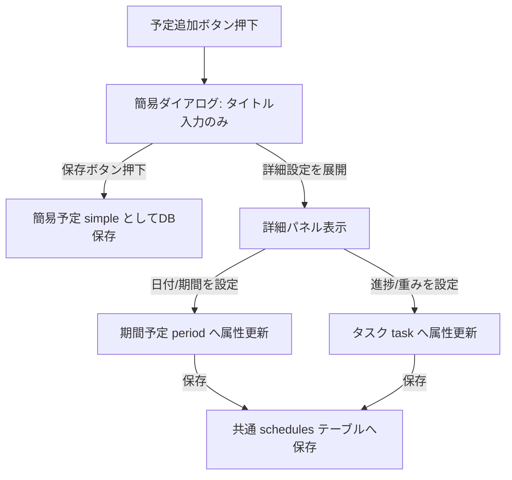

# TaskFlow 詳細設計書 (Detailed Design)

本設計書は、基本設計に基づき、PHP（Web側）および C++（Qt6デスクトップ側）の各機能モジュールの具体的なクラス設計、関数定義（メソッドシグネチャ）、実行されるSQLクエリ、および同期アルゴリズムの詳細な処理フローを定義します。

---

## 1. 開発ディレクトリ構成

各機能モジュールの独立性を確保するため、以下のディレクトリ構造で実装を行います。

### 1.1. PHP (Web側) ディレクトリ構成
```
TaskFlow/
├── config/
│   └── config.php            # 環境設定（DB接続、TransCipherトークン等）
├── database/
│   ├── schema.sql            # MySQLスキーマ
│   └── schema_sqlite.sql     # SQLiteスキーマ
├── doc/
│   ├── basic_design.md       # 基本設計書
│   └── detail_design.md      # 詳細設計書 (本ファイル)
├── src/
│   ├── Common/
│   │   └── Security/
│   │       └── CryptoUtil.php # TransCipher ラッパー
│   ├── Holiday/
│   │   └── HolidayParser.php  # 祝日CSV解析
│   ├── Notification/
│   │   └── DiscordNotifier.php# Discord Webhook通知
│   └── Repository/
│       ├── ScheduleRepository.php
│       ├── TimeSlotRepository.php
│       └── WebhookRepository.php
└── public/
    ├── index.php             # 一般閲覧用画面 (カレンダー・ガントチャート)
    └── admin.php             # 管理用Web API / 簡易ダッシュボード
```

### 1.2. C++ (Qt 6 デスクトップ側) ディレクトリ構成
```
TaskFlow-Client/
├── CMakeLists.txt            # ビルド定義
├── include/
│   # TransCipher 公開ヘッダー
│   ├── cipher_engine.h
│   └── ...
├── src/
│   ├── main.cpp
│   ├── common/
│   │   ├── crypto_util.h     # TransCipher ラッパー
│   │   └── crypto_util.cpp
│   ├── database/
│   │   ├── db_manager.h      # SQLiteコネクション管理
│   │   ├── db_manager.cpp
│   │   ├── local_storage.h   # SQLiteデータ操作 (キャッシュデータ)
│   │   └── local_storage.cpp
│   ├── network/
│   │   ├── network_manager.h  # Qt HTTP通信用クラス (QNetworkAccessManagerラッパー)
│   │   ├── network_manager.cpp
│   │   ├── sync_client.h      # PHP同期API呼び出しクライアント
│   │   └── sync_client.cpp
│   ├── model/
│   │   ├── schedule.h        # 予定データ構造
│   │   ├── time_slot.h       # 時間枠データ構造
│   │   └── webhook.h         # Webhookデータ構造
│   ├── sync/
│   │   ├── sync_engine.h     # 同期・衝突検知・解決ステート管理
│   │   └── sync_engine.cpp
│   ├── scheduler/
│   │   ├── scheduler.h       # 負荷警告計算エンジン
│   │   └── scheduler.cpp
│   └── ui/
│       ├── mainwindow.h      # メイン画面
│       ├── mainwindow.cpp
│       ├── mainwindow.ui
│       ├── conflict_dialog.h # 競合解決ダイアログ
│       ├── conflict_dialog.cpp
│       └── conflict_dialog.ui
└── thirdparty/
    └── transcipher/          # TransCipher.dll 等の配置
```


---

## 2. PHP (Web側) クラス・メソッド詳細設計

### 2.1. `CryptoUtil` クラス
`TransCipher` への依存を隠蔽し、Base64 文字列の相互変換と接続パラメータ管理を担当します。

* **`init($secretKey, $apiUrl, $apiToken)`**:
  * 秘密鍵（`$secretKey`）を静的メンバーに保持し、`TransCipher\CipherEngine::configure` を呼び出してAPI接続先と認証トークンを設定します。
* **`encrypt($plainText)`**:
  1. 引数の平文テキストが空の場合は、空文字を返却します。
  2. `CipherEngine::encrypt` を呼び出し、平文、秘密鍵、および強制AES適用モード（MANDATORY）、暗号バージョン "2.0" を指定して暗号化されたバイナリデータを取得します。
  3. API疎通エラーや無効なパラメータ等で戻り値が `null` となった場合、処理を中断して `RuntimeException` をスローします。
  4. 正常に取得されたバイナリデータを Base64 エンコードした文字列に変換して返却します。
* **`decrypt($cipherTextBase64)`**:
  1. 引数のBase64暗号文字列が空の場合は、空文字を返却します。
  2. `base64_decode` を実行して暗号バイナリデータに変換します。変換に失敗（不正なBase64文字など）した場合は `InvalidArgumentException` をスローします。
  3. `CipherEngine::decrypt` を呼び出し、暗号バイナリデータと秘密鍵を渡して平文データを取得します。
  4. API接続エラーや鍵の不一致等で戻り値が `null` となった場合、処理を中断して `RuntimeException` をスローします。
  5. 復号された平文テキストを返却します。

### 2.2. `ScheduleRepository` クラス
MySQL データベースへの予定データの保存（CRUD）を担当し、SQLの発行と暗号化・復号のタイミングを制御します。

* **`save($schedule, $allocations = [])`**:
  1. 保存対象データ（`$schedule`）の `title`（予定タイトル）を `CryptoUtil::encrypt` を用いて暗号化します。
  2. `description`（予定詳細）が存在し空でない場合は `CryptoUtil::encrypt` を用いて暗号化します（空の場合は `NULL` 値を代入）。
  3. タイプがやることメモ (`type = 'memo'`) の場合、開始日時 (`start_at`) および終了日時 (`end_at`) は `NULL` に強制設定して保存します。
  4. データベース（MySQL）に対してトランザクションを開始します。
  5. データベースに対して、重複キー時に上書きを行うための `INSERT INTO ... ON DUPLICATE KEY UPDATE` クエリをプレペアし、UUIDやその他の非暗号化カラム（期間、優先度、重み、`recurrence_group_id` 等）とともに暗号化タイトル・詳細の値を安全にバインドして実行します。
  6. 親 `schedule` の保存が成功した場合、既存のこの `schedule_id` に紐づく子レコード `schedule_allocations` を全物理削除（`DELETE FROM schedule_allocations WHERE schedule_id = :schedule_id`）します。
  7. 引数の `$allocations` 配列をループし、それぞれに新規UUIDを発行して `schedule_allocations` テーブルへ一括インサートします。
  8. トランザクションをコミットします。エラー時はロールバックして `false` を返します。
* **`findAllPublic()`**:
  1. データベース（MySQL）に対して、公開予定かつ未削除のレコード（`is_public = 1 AND is_deleted = 0`）を日付（`start_at`）昇順で取得する `SELECT` クエリを実行します。
  2. 取得したレコードセットをループ処理し、各レコードの `title` を `CryptoUtil::decrypt` で平文に復号します。また、`description` も存在する場合は同様に復号します。
  3. 各予定レコードに紐づく `schedule_allocations` を取得し、`allocations` キーとしてレコード配列内にネスト（内包）させます。
  4. 各予定レコードに紐づく `schedule_segments`（`is_deleted=0`）を `segment_order` 昇順で取得し、`segments` キーとしてネストさせます。セグメントが無い場合は空配列。
  5. タイトルと詳細が平文に復元され、日別割り当てデータとセグメントリストがネストされた予定レコードの配列を返却します。
* **`saveSegments(string $scheduleId, array $segments): bool`**:
  1. トランザクションを開始します。
  2. `schedule_id = :scheduleId AND is_deleted = 0` の既存セグメントを全て論理削除（`is_deleted=1`）します。
  3. `$segments` 配列をループし、`segment_order`（1始まり）、`start_at`、`end_at` を新規UUIDとともに `schedule_segments` にインサートします。
  4. 全セグメント保存後、`schedules.start_at` を最初のセグメントの `start_at`、`schedules.end_at` を最後のセグメントの `end_at` で更新します。
  5. トランザクションをコミットします。エラー時はロールバックして `false` を返します。
* **`findSegmentsByScheduleId(string $scheduleId): array`**:
  1. `schedule_id = :scheduleId AND is_deleted = 0` のセグメントを `segment_order` 昇順で取得して返却します。
* **`deleteSeries($recurrenceGroupId)`**:
  1. `recurrence_group_id` に紐づくすべてのレコードを一括論理削除（`is_deleted = 1`）します。

### 2.3. 一般閲覧画面（`index.php`）の制御ロジック
* **ログイン・ログアウト処理**:
  * 一般画面でログインPOSTリクエスト（パラメータ: `form_action = index_login`, `password`）を検知した際、`admin.php` と同様に `password_verify` で管理者パスワードハッシュと比較検証します。認証成功時は、セッションIDを再生成した上で `$_SESSION['admin_logged_in'] = true` をセットし、`$_SERVER['PHP_SELF']` を用いて正しいパスにリダイレクトして非公開データを含む全件をロードします。
  * `index.php?action=logout` アクセス時は、セッションをクリアした上で `$_SERVER['PHP_SELF']` を用いて正しいパスの `index.php` へリダイレクトし、ログイン状態を解除します。
* **ガントチャート描画ロジック (JavaScript) — セグメント対応**:
  * 各タスクの `segments` 配列を参照し、セグメントが存在する場合は同一行に複数のガントバーを描画。セグメントが無い場合は従来通り `start_at / end_at` の単一バー。
  * 同一タスクの各セグメントを `segment_order` 順に処理し、それぞれの `start_at` / `end_at` からガント内のピクセル位置を計算して描画。
  * セグメント間の空白範囲（他タスクが入る期間）はバーを描画せず、ボッチした表示にする。
  * タスクのタイトルは最初のセグメントのバー内に表示する。
* **カテゴリのGETパラメータ連動および表示トグル（JavaScript側）**:
  * 画面起動時に `URLSearchParams` を用いて `categories` パラメータを抽出し、カンマ区切りで複数のカテゴリを取得。それを `selectedCategories` セットに初期登録します。
  * `initCategoryFilters` 実行時に、該当するカテゴリバッジ（チップ）に `.active` クラスを自動付与して初期レンダリングを行います。
  * カテゴリバッジがクリックされた際、`selectedCategories` セットを更新したのち、`history.replaceState` を用いて、ブラウザのURLパラメータを `?categories=cat1,cat2` のようにリアルタイムに上書きします（ページのリロードは行いません）。
  * **表示トグル機能**: ラベル部分のクリックイベントから `toggleCategoryFilterVisibility()` 関数を実行し、変数 `filterVisible` の状態に応じてカテゴリチップ群の親要素の `display` プロパティを `block` / `none` に切り替えます。同時に、矢印アイコンの回転（CSS `transform` による `rotate`）を連動させます。
* **日曜開始カレンダーの描画アルゴリズム (JavaScript)**:
  * **曜日ヘッダーの描画**: 配列 `dayNames = ['日', '月', '火', '水', '木', '金', '土']` に基づいて曜日を表示します。
  * **月間カレンダーの日付余白計算**: 初日の曜日インデックス（0:日, 1:月, ...）をそのまま前月の余白日数（`prevDaysOffset = startDay`）として扱い、カレンダー開始日を算出します。
  * **週間スケジュールの開始日算出**: `getStartOfWeek` 関数にて、渡された日付からその週の日曜日の日付（`date.getDate() - date.getDay()`）を算出して返します。
* **ヘッダー簡素化およびフッターコピーライトの追加 (HTML/CSS)**:
  * `logo-area` の内容を削除し、ヘッダーにはナビゲーション、ログイン・ログアウトボタンおよびビュー切替コントロールのみを配置します。
  * カレンダー領域（`main`）の直後に `<footer>` を新設し、境界線（`border-top`）を設け、`TaskFlow`、`TransCipher`、`Qt 6`、`PHP` などの使用技術を含んだコピーライト（中央揃え・縮小フォント）を表示します。

### 2.4. 管理者用パスワード変更処理（`admin.php`）
* **パスワード変更ロジック**:
  1. フォームアクション `change_password` 処理にて、現在のパスワード、新しいパスワード、確認用パスワードのPOST値を受信します。
* **入力フォームのHELP補助テキスト追加**:
  - `admin.php` 内の各種設定フォームの対象項目の直下に、入力補助説明用の段落（`p`タグ）を追加します。
  - 各HELPテキストは `font-size: 0.75rem`, `color: var(--text-secondary)`, `margin-top: 0.25rem`, `line-height: 1.4` でスタイリングします。
  - **対象箇所と表示文言**:
    - **予定の種類 (`sched-type`)**: `※ 簡易予定：日時のみのシンプルな予定。期間予定：複数日にまたがる予定。個人タスク：時間枠に割り当て、重み（所要時間）を集計する進捗管理用の予定。`
    - **カテゴリ/タグ (`sched-category`)**: `※ 予定の分類タグ（一般画面での絞り込みフィルターで使用）。半角英数字で入力してください。`
    - **時間枠の名前 (`slot-name`)**: `※ カレンダー上でタスクの所要時間を集計・管理する単位となる名前（例: 午前枠、午後枠）。`
    - **許容作業時間 (`slot-limit`)**: `※ 1日のうち、この時間枠に割り当てられるタスクの最大合計時間（例: 午前枠なら3.0時間）。これを超えると負荷警告ハイライトが作動します。`
    - **Discord Webhook URL (`wh-url`)**: `※ Discordの対象テキストチャンネルの「設定」➔「連携サービス」➔「ウェブフックを作成」➔「ウェブフックURLをコピー」から取得したURLを入力してください。`
  2. バリデーションチェック（新しいパスワードの文字数が6文字以上、確認用との一致）を行います。
  3. `password_verify($currentPassword, ADMIN_PASSWORD_HASH)` を用いて現在のパスワードの整合性を確認します。
  4. 新しいパスワードを `password_hash($newPassword, PASSWORD_BCRYPT)` でハッシュ化します。
  5. 設定ファイル `config.php` の文字列を読み込み、元のハッシュ行（`define('ADMIN_PASSWORD_HASH', '...');`）を特定します（`define('ADMIN_PASSWORD_HASH', '` + `ADMIN_PASSWORD_HASH` + `');`）。
  6. 新しいハッシュ行を作成し、`str_replace` によりソースコード内の該当行を置換します。
  7. ファイル書き込み中の予期せぬエラーやサーバー停止によるファイル破損を避けるため、まず一時ファイル（`config.php.tmp`）にコンテンツを書き出します。書き出し完了後、`rename` 関数を使用してアトミックに元の `config.php` と差し替えます。

### 2.5. 繰り返し予定（同月内限定）の処理詳細
* **繰り返し日程の算出アルゴリズム (PHP/admin.php)**
  * 入力された開始日 ($D_{start}$) の月（年・月）を取得します。
  * その月の最終日（月末日: $D_{end\_of\_month}$）を算出します。
  * $D_{start} + 1$ 日から $D_{end\_of\_month}$ までの各日付 $d$ に対してループを回し、選択された繰り返しパターンと合致するかどうか判定します：
    * **毎日 (daily)**：すべての日付 $d$ をコピー対象とします。
    * **毎週同じ曜日 (weekly)**：$d$ の曜日インデックスが $D_{start}$ の曜日インデックスと一致する場合、コピー対象とします。
    * **平日のみ (weekdays)**：$d$ の曜日が月〜金曜日（曜日インデックス 1〜5）の場合、コピー対象とします。
* **個別レコードの生成と保存フロー**
  1. 新規予定登録時、繰り返し設定が有効（「なし」以外）の場合、新規のグループUUID $G_{id}$ を発行し、オリジナル予定の `recurrence_group_id` に設定して保存します。
  2. 算出されたすべてのコピー対象日について、新しい予定UUID $ID_{new}$ を発行します。
  3. オリジナル予定のプロパティ（タイトル、詳細、カテゴリ、公開フラグ等）をコピーし、開始日時・終了日時の「日付部分」のみを対象日に書き換えて、同一の `recurrence_group_id` ($G_{id}$) を付与した別レコードとして `schedules` テーブルへ個別にインサートします。
* **シリーズ編集・削除の処理フロー**
  * 編集・削除対象の予定に `recurrence_group_id` が設定されている場合、UI上で「この予定のみ」または「シリーズ全体」を選択させます。
  * **シリーズ全体の削除**:
    * 送信された `recurrence_group_id` を持つすべてのスケジュールに対して、論理削除クエリを実行します：
      ```sql
      UPDATE schedules SET is_deleted = 1, updated_at = NOW() WHERE recurrence_group_id = :recurrence_group_id;
      ```
  * **シリーズ全体の編集**:
    * 送信された `recurrence_group_id` を持つすべてのスケジュールに対し、タイトル・詳細・カテゴリ・公開設定等の共通プロパティを一括更新します。ただし、開始日時・終了日時は各コピーの日付を維持するため、差分更新（または日付部分を除くカラムの個別更新）を行います。
  * **この予定のみの編集**:
    * 選択した特定の予定レコードのみを更新し、`recurrence_group_id` を `NULL` にクリアしてシリーズから切り離します（これにより以後のシリーズ一括変更の影響を受けなくなります）。

### 2.6. やることメモ（日付未定）機能の処理詳細
* **一般カレンダー画面における非表示制御 (`index.php`)**:
  - `index.php` 側のデータ抽出・描画フィルターにおいて、`sched.type !== 'memo'` を明示的に条件に加え、日付データを持たないメモタイプが一般公開画面に描画されることを防御します。
* **管理画面での分離・一覧表示と移行フロー (`admin.php`)**:
  - **管理一覧の分離**:
    - 通常のスケジュールテーブルからは `type !== 'memo'` でフィルタリングしてメモを除外します。
    - 別途、やることメモ管理用セクション (`section-memos`) を新設し、`type === 'memo'` かつ `is_deleted = 0` の予定のみをリスト表示します。
  - **移行 JS アクション (`migrateMemoToSchedule`)**:
    1. 「予定/タスクに移行」ボタンクリック時に、メモデータオブジェクトを引数にして実行します。
    2. 新規/編集フォームの `sched-id` などのフィールドにメモのデータを流し込みます。
    3. `sched-type` のセレクトボックス値を `simple` （または `task`）に変更します。
    4. `toggleFormFields()` をトリガーして非表示になっていた日付入力欄（開始・終了日時）を表示状態にします。
    5. 開始日付入力欄 (`sched-start`) にフォーカスを移動してユーザーに日付入力を促します。
    6. 保存ボタン押下時、`type` が `simple` 等に書き換わり、開始日時・終了日時がバインドされて `save_schedule` として POST されるため、DB上で自動的にカレンダー予定へ移行完了します。

---

## 3. C++ (Qt 6) クラス・同期プロトコルの詳細設計

### 3.1. `CryptoUtil` クラス (C++)
`QByteArray` と `QString` のエンコード処理および `TransCipher` CLI/DLL 連携を仲介します。

* **`init(secretKey)`**:
  * 秘密鍵（`m_secretKey`）を静的メンバーに保持します。
* **`encrypt(plainText)`**:
  1. 秘密鍵または引数の平文が空の場合は、空文字を返却します。
  2. 平文（`QString`）を UTF-8 エンコードしたバイト配列（`QByteArray`）へ変換します。
  3. `CipherEngine::encrypt` を呼び出し、バイト配列、秘密鍵、および強制AES適用モード（`AesMode::Mandatory`）を指定して暗号化結果（`CipherResult`）を取得します。
  4. 処理が成功（`isSuccess()`）した場合、取得したバイナリデータを Base64 エンコードし、`QString` に変換して返却します。
  5. 処理が失敗した場合は、エラーメッセージを取得して `std::runtime_error` をスローします。
* **`decrypt(cipherTextBase64)`**:
  1. 秘密鍵または引数のBase64暗号文字列が空の場合は、空文字を返却します。
  2. Base64暗号文字列をデコードし、暗号バイナリ（`QByteArray`）に変換します。
  3. `CipherEngine::decrypt` を呼び出し、暗号バイナリと秘密鍵を渡して復号結果（`CipherResult`）を取得します。
  4. 処理が成功した場合、復元されたバイナリデータを UTF-8 から `QString` へデコードして返却します。
  5. 処理が失敗した場合は、エラーメッセージを取得して `std::runtime_error` をスローします。


### 3.2. `SyncEngine` クラス (同期処理・衝突検知)
同期処理の開始から完了までを制御するクラスです。シグナル・スロットを使わず、指定されたレシーバ（UI側）へカスタムイベントをポストする構成とします。

```cpp
// sync_engine.h
#ifndef SYNC_ENGINE_H
#define SYNC_ENGINE_H

#include <QObject>
#include <QDateTime>
#include <QEvent>
#include "model/schedule.h"

// カスタムイベントのタイプ定義
enum TaskFlowEventType {
    SyncProgressType = QEvent::User + 1,
    SyncConflictType,
    SyncFinishedType
};

// カスタムイベントクラス群
class SyncProgressEvent : public QEvent {
public:
    SyncProgressEvent(int percentage)
        : QEvent(static_cast<QEvent::Type>(SyncProgressType)), m_percentage(percentage) {}
    int percentage() const { return m_percentage; }
private:
    int m_percentage;
};

class SyncConflictEvent : public QEvent {
public:
    SyncConflictEvent(const Schedule& localSched, const Schedule& remoteSched)
        : QEvent(static_cast<QEvent::Type>(SyncConflictType)), m_localSched(localSched), m_remoteSched(remoteSched) {}
    Schedule localSchedule() const { return m_localSched; }
    Schedule remoteSchedule() const { return m_remoteSched; }
private:
    Schedule m_localSched;
    Schedule m_remoteSched;
};

class SyncFinishedEvent : public QEvent {
public:
    SyncFinishedEvent(bool success, const QString& message)
        : QEvent(static_cast<QEvent::Type>(SyncFinishedType)), m_success(success), m_message(message) {}
    bool success() const { return m_success; }
    QString message() const { return m_message; }
private:
    bool m_success;
    QString m_message;
};

class SyncEngine {
public:
    // レシーバオブジェクト(UIスレッドのMainWindow等)を登録して非同期通知に利用する
    explicit SyncEngine(QObject *receiver = nullptr);
    void setReceiver(QObject *receiver);

    // 同期処理を非同期で開始する
    void startSync();

    // 競合解決結果を受け取って同期処理を再開する
    void resolveConflict(const Schedule& resolvedSched);

private:
    // 同期手順
    void pullRemoteChanges();
    void pushLocalChanges();

    QObject *m_receiver;
    QDateTime m_lastSyncedAt;
    QList<Schedule> m_conflictedSchedules;
};

#endif // SYNC_ENGINE_H
```

#### UI側 (MainWindow) のカスタムイベントハンドリング
UIクラスは下位モジュールからポストされたカスタムイベントを `customEvent` をオーバーライドして受信します。

```cpp
// mainwindow.cpp 内の実装例
void MainWindow::customEvent(QEvent *event) {
    if (event->type() == static_cast<QEvent::Type>(SyncProgressType)) {
        auto *progressEvent = static_cast<SyncProgressEvent*>(event);
        ui->progressBar->setValue(progressEvent->percentage());
    } else if (event->type() == static_cast<QEvent::Type>(SyncConflictType)) {
        auto *conflictEvent = static_cast<SyncConflictEvent*>(event);
        // 競合解決ダイアログを表示（モーダル表示して解決データを待つ）
        showConflictDialog(conflictEvent->localSchedule(), conflictEvent->remoteSchedule());
    } else if (event->type() == static_cast<QEvent::Type>(SyncFinishedType)) {
        auto *finishedEvent = static_cast<SyncFinishedEvent*>(event);
        handleSyncFinished(finishedEvent->success(), finishedEvent->message());
    }
    QMainWindow::customEvent(event);
}
```

#### 同期時のデータ競合（衝突）検出クエリの流れ

1. **MySQL 側からの更新取得（プル）**:
   * SQLite 内の $T_{sync}$ (`last_synced_at`) を取得。
   * MySQL に接続し、最終同期時刻以降に変更された全レコードを取得する。
     ```sql
     SELECT * FROM schedules WHERE updated_at > :last_synced_at;
     ```
2. **SQLite 側からの更新取得（プッシュ対象）**:
   * SQLite から、最終同期時刻以降に変更されたローカルの全レコードを取得する。
     ```sql
     SELECT * FROM schedules WHERE updated_at > :last_synced_at;
     ```
3. **衝突の判定**:
   * リモート更新リスト ($R_{list}$) とローカル更新リスト ($L_{list}$) の中で、`id` (UUID) が一致するレコードが存在するか走査する。
   * 一致するレコードが存在し、かつデータの中身（暗号化タイトル、詳細、ステータス、時間枠ID等）に差分がある場合、**衝突 (Conflict)** と判定し、`conflictDetected` シグナルを発火する。

---

## 4. UI 遷移と状態制御設計

### 4.1. 衝突（競合）解決ダイアログ (`ConflictDialog`)
同期エンジンが衝突を検知すると、GUIスレッドがダイアログを表示して同期処理を一時サスペンドします。

* **UI構造**:
  * 画面左側: **ローカル(SQLite)データ** (更新日時、タイトル、詳細、ステータス、担当時間枠)
  * 画面右側: **リモート(MySQL)データ** (更新日時、タイトル、詳細、ステータス、担当時間枠)
  * 下部中央: **解決マージ入力エリア** (デフォルトで最新更新時間のデータをプレロード、自由編集可能)
  * 操作ボタン: `[ローカルを優先]`、`[リモートを優先]`、`[手動マージ内容で確定]`
* **処理フロー**:
  1. ボタンが押下されると、ダイアログは選択された解決データを `Schedule` 構造体に格納して `SyncEngine` の `resolveConflict` スロットへ返却します。
  2. 同期エンジンは、そのデータを MySQL と SQLite の双方に `updated_at = NOW()` を付与して更新保存し、サスペンドしていた同期処理を再開（次の競合レコードの検査へ移行）します。

### 4.2. シームレスな予定登録UIのフロー
「簡易予定」「期間予定」「個人タスク」の登録ステップを統一するフローです。



* **C++ (Qt6) 登録UI**:
  * 登録フォームには、タイトル入力用の `QLineEdit` のみが初期表示されます。
  * 「詳細を設定する」ボタンを押すとスライド（アコーディオン形式）で日付範囲選択（`QDateTimeEdit`）、重みスピンボックス（`QDoubleSpinBox`）、時間枠コンボボックス（`QComboBox`）が表示されます。
  * 保存処理時、入力値の有無をチェックし：
    * `weight == 0.0 && start_at == NULL` ➔ `type = 'simple'`
    * `weight == 0.0 && start_at != NULL` ➔ `type = 'period'`
    * `weight > 0.0` ➔ `type = 'task'`
    として判定し、`type` カラムに代入してDBへ保存します。

---

## 5. CMake ビルド環境非依存設計 (CMakeLists.txt)

C++（Qt 6）デスクトップアプリのビルド定義において、開発者個人の特定PC環境に依存する絶対パス情報（Qtのインストール先やTransCipherのローカル配置ディレクトリなど）の混入を防ぐため、以下のルールで `CMakeLists.txt` を設計します。

### 5.1. Qt 6 パッケージの探索
特定のローカルパス（例: `C:/Qt/...`）を `CMakeLists.txt` 内に記述することを厳禁とします。
* **標準的な探索手法の採用**:
  `find_package` を用いてモジュールを検索します。
  ```cmake
  find_package(Qt6 COMPONENTS Core Widgets Sql REQUIRED)
  ```
* **環境情報の外部定義**:
  Qtのインストールパスは、ビルドツール（Qt Creator や CLI）の起動オプション（`-DCMAKE_PREFIX_PATH`）または環境変数（`CMAKE_PREFIX_PATH`）から外部注入し、CMake自体はそれに追従する設計とします。

### 5.2. サードパーティ（TransCipher）の探索と配置
開発用リポジトリに依存したパス指定を行わず、プロジェクトディレクトリ内部の相対パス（`${CMAKE_CURRENT_SOURCE_DIR}`）で統一します。

* **インクルードパス・リンクライブラリの設定**:
  ```cmake
  # プロジェクト内の相対パスでインクルードとライブラリを指定
  target_include_directories(TaskFlow-Client PRIVATE ${CMAKE_CURRENT_SOURCE_DIR}/include)
  target_link_directories(TaskFlow-Client PRIVATE ${CMAKE_CURRENT_SOURCE_DIR}/thirdparty/transcipher)
  target_link_libraries(TaskFlow-Client PRIVATE TransCipher)
  ```
* **DLLの自動配置（ビルド後コピー）**:
  ビルド後のバイナリ実行時に DLL が見つからないエラーを防ぐため、PCごとの手動コピーに頼らず、CMake 内でターゲットの出力ディレクトリ（`${CMAKE_BINARY_DIR}` 等）へ `TransCipher.dll` を自動コピーするビルド後カスタムコマンドを定義します。
  ```cmake
  if(WIN32)
      add_custom_command(TARGET TaskFlow-Client POST_BUILD
          COMMAND ${CMAKE_COMMAND} -E copy_if_different
          "${CMAKE_CURRENT_SOURCE_DIR}/thirdparty/transcipher/TransCipher.dll"
          $<TARGET_FILE_DIR:TaskFlow-Client>
      )
  endif()
  ```

---

## 先行タスク機能 詳細設計

### 1. schedule_predecessors テーブル詳細

| カラム | 型 (MySQL) | 型 (SQLite) | 制約 | 説明 |
|---|---|---|---|---|
| id | VARCHAR(36) | TEXT | PK | UUID v4 |
| schedule_id | VARCHAR(36) | TEXT | FK→schedules.id CASCADE | 後続タスクID |
| predecessor_id | VARCHAR(36) | TEXT | FK→schedules.id CASCADE | 先行タスクID |
| ― | ― | ― | UNIQUE(schedule_id, predecessor_id) | 重複防止 |

### 2. ScheduleRepository 追加メソッド詳細

#### savePredecessors(string , array ): bool

`
1. トランザクション開始
2. DELETE FROM schedule_predecessors WHERE schedule_id = :sid  （既存全削除）
3.  が空でなければ：
   -  自身を除外（自己参照防止）
   - 各  に対して INSERT INTO schedule_predecessors (id, schedule_id, predecessor_id) VALUES (uuid, :sid, :pid)
4. トランザクションコミット
5. 失敗時はロールバックして false を返す
`

#### indPredecessorsByScheduleId(string ): array

`sql
SELECT p.*, s.title AS pred_title, s.start_at AS pred_start, s.end_at AS pred_end
FROM schedule_predecessors p
JOIN schedules s ON p.predecessor_id = s.id
WHERE p.schedule_id = :schedule_id AND s.is_deleted = 0
ORDER BY s.start_at ASC
`

#### indSuccessorsByScheduleId(string ): array

`sql
SELECT p.*, s.title AS succ_title, s.start_at AS succ_start, s.end_at AS succ_end
FROM schedule_predecessors p
JOIN schedules s ON p.schedule_id = s.id
WHERE p.predecessor_id = :predecessor_id AND s.is_deleted = 0
ORDER BY s.start_at ASC
`

#### indAllPredecessorRelations(): array

`sql
SELECT schedule_id, predecessor_id FROM schedule_predecessors
`
（index.php でガントチャート描画用に全ペアを一括取得するためのメソッド）

### 3. dmin.php 先行タスク選択UI 詳細

- スケジュール編集フォームの「セグメント設定」セクションの直後に「先行タスク」セクションを追加する。
- <select multiple> で既存の全スケジュール（is_deleted = 0, 	ype IN ('task','period')）を選択肢として列挙する。
- 自分自身は選択肢から除外する。
- フォーム送信時: $_POST['predecessors'] として ID 配列が渡される（未選択時は空配列）。
- save_schedule アクション処理の末尾で $repo->savePredecessors(, ) を呼ぶ。

### 4. index.php ガントチャート矢印描画 詳細

- PHP側: indAllPredecessorRelations() でペア配列を取得し、JSON エンコードして <script> タグに埋め込む。
- JavaScript側: ガントチャートの各バー要素にはスケジュールIDを data-schedule-id 属性として付与する。
- 矢印描画ロジック:
  1. predecessorRelations 配列をループ
  2. predecessor_id の DOM バー要素と schedule_id の DOM バー要素を取得
  3. 各バーの getBoundingClientRect() から座標を算出
  4. SVGオーバーレイ（ガントチャートコンテナ上に絶対配置）に <path> マーカー付き矢印を描画
  5. スクロール・リサイズ時に再描画