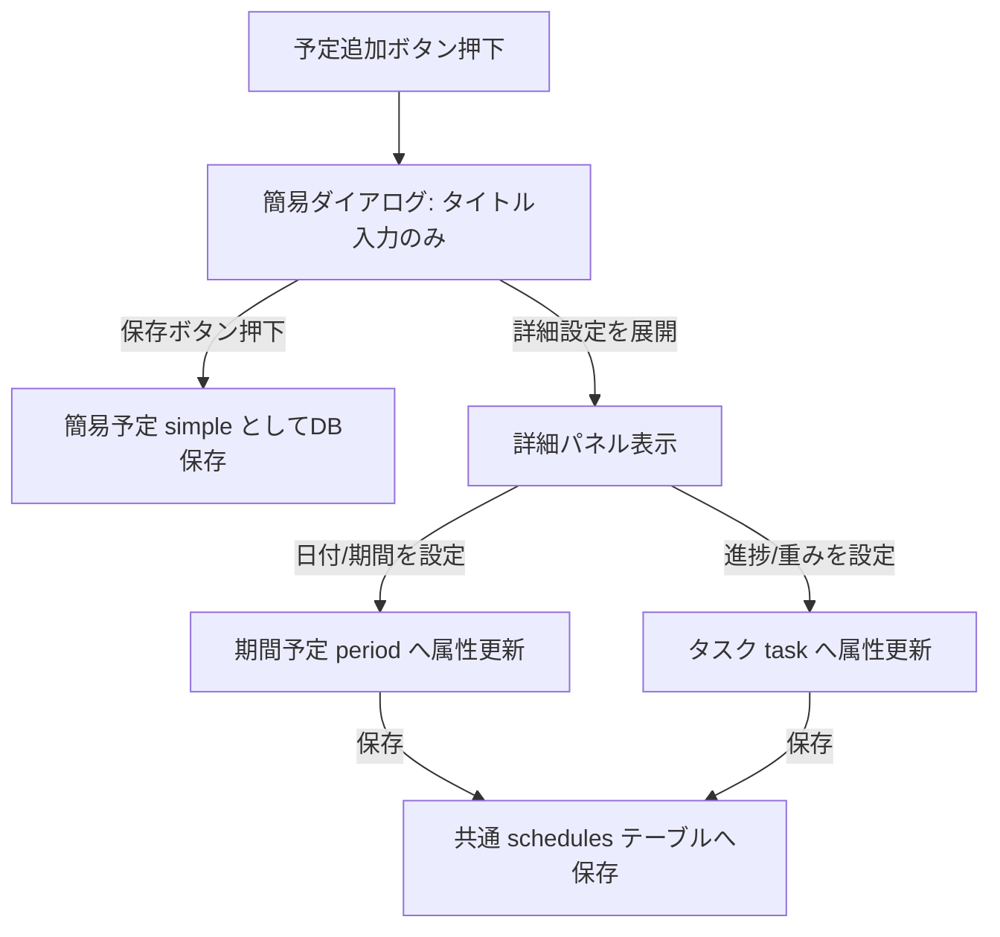

# TaskFlow 詳細設計書 (Detailed Design)

本設計書は、基本設計に基づき、PHP（Web側）および C++（Qt6デスクトップ側）の各機能モジュールの具体的なクラス設計、関数定義（メソッドシグネチャ）、実行されるSQLクエリ、および同期アルゴリズムの詳細な処理フローを定義します。

---

## 1. 開発ディレクトリ構成

各機能モジュールの独立性を確保するため、以下のディレクトリ構造で実装を行います。

### 1.1. PHP (Web側) ディレクトリ構成
```
TaskFlow/
├── config/
│   └── config.php            # 環境設定（DB接続、TransCipherトークン等）
├── database/
│   ├── schema.sql            # MySQLスキーマ
│   └── schema_sqlite.sql     # SQLiteスキーマ
├── doc/
│   ├── basic_design.md       # 基本設計書
│   └── detail_design.md      # 詳細設計書 (本ファイル)
├── src/
│   ├── Common/
│   │   └── Security/
│   │       └── CryptoUtil.php # TransCipher ラッパー
│   ├── Holiday/
│   │   └── HolidayParser.php  # 祝日CSV解析
│   ├── Notification/
│   │   └── DiscordNotifier.php# Discord Webhook通知
│   └── Repository/
│       ├── ScheduleRepository.php
│       ├── TimeSlotRepository.php
│       └── WebhookRepository.php
└── public/
    ├── index.php             # 一般閲覧用画面 (カレンダー・ガントチャート)
    └── admin.php             # 管理用Web API / 簡易ダッシュボード
```

### 1.2. C++ (Qt 6 デスクトップ側) ディレクトリ構成
```
TaskFlow-Client/
├── CMakeLists.txt            # ビルド定義
├── include/
│   # TransCipher 公開ヘッダー
│   ├── cipher_engine.h
│   └── ...
├── src/
│   ├── main.cpp
│   ├── common/
│   │   ├── crypto_util.h     # TransCipher ラッパー
│   │   └── crypto_util.cpp
│   ├── database/
│   │   ├── db_manager.h      # SQLiteコネクション管理
│   │   ├── db_manager.cpp
│   │   ├── local_storage.h   # SQLiteデータ操作 (キャッシュデータ)
│   │   └── local_storage.cpp
│   ├── network/
│   │   ├── network_manager.h  # Qt HTTP通信用クラス (QNetworkAccessManagerラッパー)
│   │   ├── network_manager.cpp
│   │   ├── sync_client.h      # PHP同期API呼び出しクライアント
│   │   └── sync_client.cpp
│   ├── model/
│   │   ├── schedule.h        # 予定データ構造
│   │   ├── time_slot.h       # 時間枠データ構造
│   │   └── webhook.h         # Webhookデータ構造
│   ├── sync/
│   │   ├── sync_engine.h     # 同期・衝突検知・解決ステート管理
│   │   └── sync_engine.cpp
│   ├── scheduler/
│   │   ├── scheduler.h       # 負荷警告計算エンジン
│   │   └── scheduler.cpp
│   └── ui/
│       ├── mainwindow.h      # メイン画面
│       ├── mainwindow.cpp
│       ├── mainwindow.ui
│       ├── conflict_dialog.h # 競合解決ダイアログ
│       ├── conflict_dialog.cpp
│       └── conflict_dialog.ui
└── thirdparty/
    └── transcipher/          # TransCipher.dll 等の配置
```


---

## 2. PHP (Web側) クラス・メソッド詳細設計

### 2.1. `CryptoUtil` クラス
`TransCipher` への依存を隠蔽し、Base64 文字列の相互変換と接続パラメータ管理を担当します。

* **`init($secretKey, $apiUrl, $apiToken)`**:
  * 秘密鍵（`$secretKey`）を静的メンバーに保持し、`TransCipher\CipherEngine::configure` を呼び出してAPI接続先と認証トークンを設定します。
* **`encrypt($plainText)`**:
  1. 引数の平文テキストが空の場合は、空文字を返却します。
  2. `CipherEngine::encrypt` を呼び出し、平文、秘密鍵、および強制AES適用モード（MANDATORY）、暗号バージョン "2.0" を指定して暗号化されたバイナリデータを取得します。
  3. API疎通エラーや無効なパラメータ等で戻り値が `null` となった場合、処理を中断して `RuntimeException` をスローします。
  4. 正常に取得されたバイナリデータを Base64 エンコードした文字列に変換して返却します。
* **`decrypt($cipherTextBase64)`**:
  1. 引数のBase64暗号文字列が空の場合は、空文字を返却します。
  2. `base64_decode` を実行して暗号バイナリデータに変換します。変換に失敗（不正なBase64文字など）した場合は `InvalidArgumentException` をスローします。
  3. `CipherEngine::decrypt` を呼び出し、暗号バイナリデータと秘密鍵を渡して平文データを取得します。
  4. API接続エラーや鍵の不一致等で戻り値が `null` となった場合、処理を中断して `RuntimeException` をスローします。
  5. 復号された平文テキストを返却します。

### 2.2. `ScheduleRepository` クラス
MySQL データベースへの予定データの保存（CRUD）を担当し、SQLの発行と暗号化・復号のタイミングを制御します。

* **`save($schedule)`**:
  1. 保存対象データ（`$schedule`）の `title`（予定タイトル）を `CryptoUtil::encrypt` を用いて暗号化します。
  2. `description`（予定詳細）が存在し空でない場合は `CryptoUtil::encrypt` を用いて暗号化します（空の場合は `NULL` 値を代入）。
  3. データベース（MySQL）に対して、重複キー時に上書きを行うための `INSERT INTO ... ON DUPLICATE KEY UPDATE` クエリをプレペアし、UUIDやその他の非暗号化カラム（期間、優先度、重み等）とともに暗号化タイトル・詳細の値を安全にバインドして実行します。
  4. クエリ実行の成否（成功時は `true`、失敗時は `false`）を返却します。
* **`findAllPublic()`**:
  1. データベース（MySQL）に対して、公開予定かつ未削除のレコード（`is_public = 1 AND is_deleted = 0`）を日付（`start_at`）昇順で取得する `SELECT` クエリを実行します。
  2. 取得したレコードセットをループ処理し、各レコードの `title` を `CryptoUtil::decrypt` で平文に復号します。また、`description` も存在する場合は同様に復号します。
  3. タイトルと詳細が平文に復元された予定レコードの配列を返却します。


---

## 3. C++ (Qt 6) クラス・同期プロトコルの詳細設計

### 3.1. `CryptoUtil` クラス (C++)
`QByteArray` と `QString` のエンコード処理および `TransCipher` CLI/DLL 連携を仲介します。

* **`init(secretKey)`**:
  * 秘密鍵（`m_secretKey`）を静的メンバーに保持します。
* **`encrypt(plainText)`**:
  1. 秘密鍵または引数の平文が空の場合は、空文字を返却します。
  2. 平文（`QString`）を UTF-8 エンコードしたバイト配列（`QByteArray`）へ変換します。
  3. `CipherEngine::encrypt` を呼び出し、バイト配列、秘密鍵、および強制AES適用モード（`AesMode::Mandatory`）を指定して暗号化結果（`CipherResult`）を取得します。
  4. 処理が成功（`isSuccess()`）した場合、取得したバイナリデータを Base64 エンコードし、`QString` に変換して返却します。
  5. 処理が失敗した場合は、エラーメッセージを取得して `std::runtime_error` をスローします。
* **`decrypt(cipherTextBase64)`**:
  1. 秘密鍵または引数のBase64暗号文字列が空の場合は、空文字を返却します。
  2. Base64暗号文字列をデコードし、暗号バイナリ（`QByteArray`）に変換します。
  3. `CipherEngine::decrypt` を呼び出し、暗号バイナリと秘密鍵を渡して復号結果（`CipherResult`）を取得します。
  4. 処理が成功した場合、復元されたバイナリデータを UTF-8 から `QString` へデコードして返却します。
  5. 処理が失敗した場合は、エラーメッセージを取得して `std::runtime_error` をスローします。


### 3.2. `SyncEngine` クラス (同期処理・衝突検知)
同期処理の開始から完了までを制御するステートマシンクラスです。

```cpp
// sync_engine.h
#ifndef SYNC_ENGINE_H
#define SYNC_ENGINE_H

#include <QObject>
#include <QDateTime>
#include "model/schedule.h"

class SyncEngine : public QObject {
    Q_OBJECT
public:
    explicit SyncEngine(QObject *parent = nullptr);

    // 同期処理を非同期で開始する
    void startSync();

signals:
    // 同期進捗率の更新通知
    void progressUpdated(int percentage);
    // 競合（衝突）を検知したため、UI側に解決の入力を求めるシグナル
    void conflictDetected(const Schedule& localSched, const Schedule& remoteSched);
    // 同期完了通知
    void syncFinished(bool success, const QString& message);

private:
    // 同期手順
    void pullRemoteChanges();
    void pushLocalChanges();
    void resolveConflict(const Schedule& resolvedSched);

    QDateTime m_lastSyncedAt;
    QList<Schedule> m_conflictedSchedules;
};

#endif // SYNC_ENGINE_H
```

#### 同期時のデータ競合（衝突）検出クエリの流れ

1. **MySQL 側からの更新取得（プル）**:
   * SQLite 内の $T_{sync}$ (`last_synced_at`) を取得。
   * MySQL に接続し、最終同期時刻以降に変更された全レコードを取得する。
     ```sql
     SELECT * FROM schedules WHERE updated_at > :last_synced_at;
     ```
2. **SQLite 側からの更新取得（プッシュ対象）**:
   * SQLite から、最終同期時刻以降に変更されたローカルの全レコードを取得する。
     ```sql
     SELECT * FROM schedules WHERE updated_at > :last_synced_at;
     ```
3. **衝突の判定**:
   * リモート更新リスト ($R_{list}$) とローカル更新リスト ($L_{list}$) の中で、`id` (UUID) が一致するレコードが存在するか走査する。
   * 一致するレコードが存在し、かつデータの中身（暗号化タイトル、詳細、ステータス、時間枠ID等）に差分がある場合、**衝突 (Conflict)** と判定し、`conflictDetected` シグナルを発火する。

---

## 4. UI 遷移と状態制御設計

### 4.1. 衝突（競合）解決ダイアログ (`ConflictDialog`)
同期エンジンが衝突を検知すると、GUIスレッドがダイアログを表示して同期処理を一時サスペンドします。

* **UI構造**:
  * 画面左側: **ローカル(SQLite)データ** (更新日時、タイトル、詳細、ステータス、担当時間枠)
  * 画面右側: **リモート(MySQL)データ** (更新日時、タイトル、詳細、ステータス、担当時間枠)
  * 下部中央: **解決マージ入力エリア** (デフォルトで最新更新時間のデータをプレロード、自由編集可能)
  * 操作ボタン: `[ローカルを優先]`、`[リモートを優先]`、`[手動マージ内容で確定]`
* **処理フロー**:
  1. ボタンが押下されると、ダイアログは選択された解決データを `Schedule` 構造体に格納して `SyncEngine` の `resolveConflict` スロットへ返却します。
  2. 同期エンジンは、そのデータを MySQL と SQLite の双方に `updated_at = NOW()` を付与して更新保存し、サスペンドしていた同期処理を再開（次の競合レコードの検査へ移行）します。

### 4.2. シームレスな予定登録UIのフロー
「簡易予定」「期間予定」「個人タスク」の登録ステップを統一するフローです。



* **C++ (Qt6) 登録UI**:
  * 登録フォームには、タイトル入力用の `QLineEdit` のみが初期表示されます。
  * 「詳細を設定する」ボタンを押すとスライド（アコーディオン形式）で日付範囲選択（`QDateTimeEdit`）、重みスピンボックス（`QDoubleSpinBox`）、時間枠コンボボックス（`QComboBox`）が表示されます。
  * 保存処理時、入力値の有無をチェックし：
    * `weight == 0.0 && start_at == NULL` ➔ `type = 'simple'`
    * `weight == 0.0 && start_at != NULL` ➔ `type = 'period'`
    * `weight > 0.0` ➔ `type = 'task'`
    として判定し、`type` カラムに代入してDBへ保存します。

---

## 5. CMake ビルド環境非依存設計 (CMakeLists.txt)

C++（Qt 6）デスクトップアプリのビルド定義において、開発者個人の特定PC環境に依存する絶対パス情報（Qtのインストール先やTransCipherのローカル配置ディレクトリなど）の混入を防ぐため、以下のルールで `CMakeLists.txt` を設計します。

### 5.1. Qt 6 パッケージの探索
特定のローカルパス（例: `C:/Qt/...`）を `CMakeLists.txt` 内に記述することを厳禁とします。
* **標準的な探索手法の採用**:
  `find_package` を用いてモジュールを検索します。
  ```cmake
  find_package(Qt6 COMPONENTS Core Widgets Sql REQUIRED)
  ```
* **環境情報の外部定義**:
  Qtのインストールパスは、ビルドツール（Qt Creator や CLI）の起動オプション（`-DCMAKE_PREFIX_PATH`）または環境変数（`CMAKE_PREFIX_PATH`）から外部注入し、CMake自体はそれに追従する設計とします。

### 5.2. サードパーティ（TransCipher）の探索と配置
開発用リポジトリに依存したパス指定を行わず、プロジェクトディレクトリ内部の相対パス（`${CMAKE_CURRENT_SOURCE_DIR}`）で統一します。

* **インクルードパス・リンクライブラリの設定**:
  ```cmake
  # プロジェクト内の相対パスでインクルードとライブラリを指定
  target_include_directories(TaskFlow-Client PRIVATE ${CMAKE_CURRENT_SOURCE_DIR}/include)
  target_link_directories(TaskFlow-Client PRIVATE ${CMAKE_CURRENT_SOURCE_DIR}/thirdparty/transcipher)
  target_link_libraries(TaskFlow-Client PRIVATE TransCipher)
  ```
* **DLLの自動配置（ビルド後コピー）**:
  ビルド後のバイナリ実行時に DLL が見つからないエラーを防ぐため、PCごとの手動コピーに頼らず、CMake 内でターゲットの出力ディレクトリ（`${CMAKE_BINARY_DIR}` 等）へ `TransCipher.dll` を自動コピーするビルド後カスタムコマンドを定義します。
  ```cmake
  if(WIN32)
      add_custom_command(TARGET TaskFlow-Client POST_BUILD
          COMMAND ${CMAKE_COMMAND} -E copy_if_different
          "${CMAKE_CURRENT_SOURCE_DIR}/thirdparty/transcipher/TransCipher.dll"
          $<TARGET_FILE_DIR:TaskFlow-Client>
      )
  endif()
  ```
